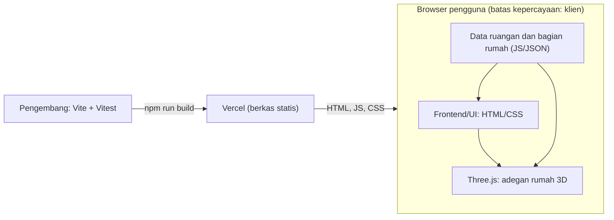

# Architecture: MiniHouse 3D Explorer

## Overview

MiniHouse 3D Explorer adalah website statis (platform web) yang berjalan seluruhnya di browser pengguna. Vite menjalankan proyek saat pengembangan dan menyiapkan hasil akhir untuk dipasang. Model rumah dibuat langsung dengan kode Three.js dari geometri dasar, tanpa model yang diimpor dari Blender. Antarmuka 2D (tombol, panel Daftar Ruangan, panel informasi, pemilih warna) dibuat dengan HTML dan CSS tanpa pustaka UI. Data ruangan dan bagian rumah disimpan di berkas JavaScript atau JSON di dalam proyek, sehingga tidak ada backend, database, maupun login. Hasil build diserahkan ke Vercel yang menyajikannya sebagai berkas statis.

## Tech Stack

| Lapisan | Pilihan | Alasan | Alternatif yang ditolak |
|---|---|---|---|
| Frontend/UI | JavaScript, Vite, Three.js (3D), HTML/CSS (UI 2D). Versi: latest stable (verifikasi: `npm view vite version`, `npm view three version`) | Ketentuan tugas dan sekalian ingin belajar Three.js (pilihan mahasiswa) | - |
| Backend | Tidak ada | Semua data simulasi cukup disimpan di berkas proyek (pilihan mahasiswa) | - |
| Database | Tidak ada; data di berkas JavaScript atau JSON | Data ruangan dan bagian rumah kecil dan tetap (pilihan mahasiswa) | - |
| Auth | Tidak ada | Tidak ada data pribadi dan hanya satu jenis pengguna (pilihan mahasiswa) | - |
| Hosting | Vercel | Pilihan mahasiswa; URL publik dibutuhkan untuk pengumpulan tugas (pilihan mahasiswa) | - |
| Testing | Vitest (unit test). Versi: latest stable (verifikasi: `npm view vitest version`) | Pilihan mahasiswa; menguji logika murni seperti data ruangan dan perhitungan posisi exploded (pilihan mahasiswa) | - |

Tidak ada item `stack.extra` karena tidak ada layanan tambahan. Alat lint memakai ESLint melalui `npm run lint`; versinya diverifikasi dengan `npm view eslint version`.

## System Diagram



## Project Structure

```text
minihouse-3d-explorer/
├── AGENTS.md              # panduan utama untuk AI dan pengembang
├── README.md              # cara menjalankan dan mengumpulkan
├── SPEC.json              # sumber kebenaran proyek
├── package.json           # skrip: dev, build, lint, test
├── index.html             # halaman tunggal, memuat kanvas dan panel UI
├── .env.example           # daftar variabel lingkungan (saat ini kosong)
├── .github/               # CI, template PR
├── docs/                  # PRD, TASKS, DECISIONS, dan dokumen lain
├── public/                # aset statis (favicon)
├── src/
│   ├── main.js            # titik masuk: menyambungkan adegan dan UI
│   ├── scene/             # kode Three.js: rumah, kamera, cahaya
│   ├── data/              # rooms.js, parts.js (data ruangan dan bagian rumah)
│   ├── ui/                # panel Daftar Ruangan, tombol, pemilih warna
│   └── styles/            # CSS
└── tests/                 # berkas Vitest
```

Struktur ini mengikuti hasil scaffold resmi Vite (template vanilla) lalu ditambah folder `scene/`, `data/`, `ui/`, dan `tests/`. Pastikan struktur dasar dengan perintah scaffold resmi `npm create vite@latest` pada task setup (T-001).

## Data Model

Data disimpan sebagai objek JavaScript di `src/data/`, bukan di database.

**Ruangan** (`src/data/rooms.js`)

| Field | Tipe | Keterangan |
|---|---|---|
| id | string | Pengenal unik ruangan, mis. untuk menyorot objek di adegan |
| nama | string | Nama ruangan yang tampil di panel |
| fungsi | string | Penjelasan singkat fungsi ruangan (F6) |

**BagianRumah** (`src/data/parts.js`)

| Field | Tipe | Keterangan |
|---|---|---|
| id | string | Pengenal unik bagian, mis. atap, dinding, lantai |
| nama | string | Nama bagian yang tampil di antarmuka |
| kelompok | string | Kelompok untuk Exploded View (F3) dan Interior View (F2) |
| warnaBawaan | string | Kode warna awal; dipakai F5 dan untuk mengembalikan warna |

Relasi: setiap Ruangan berada di dalam satu atau beberapa BagianRumah (lantai dan dinding) pada model, dan ruangan dihubungkan ke objek 3D lewat `id`. Tidak ada field data pribadi (`personal_data` = none).

## Data Flow

1. **Menjelajah rumah (F1).** Pengguna menyeret atau mencubit layar, kontrol kamera Three.js memperbarui sudut dan jarak kamera, lalu adegan digambar ulang. Batas jarak minimum dan maksimum divalidasi di kode kontrol kamera.
2. **Melihat informasi ruangan (F6, F2).** Pengguna memilih nama di panel Daftar Ruangan atau (saat Interior View aktif) mengklik ruangan di model; kode mencari `id` ruangan di `src/data/rooms.js`, lalu panel informasi menampilkan nama dan fungsi dan model menyorot ruangan itu. Bila `id` tidak ditemukan, panel menampilkan pesan data belum tersedia.
3. **Mengubah tampilan (F3, F5, F4).** Tombol atau pemilih warna memicu perubahan keadaan di kode (posisi bagian untuk Exploded, warna bahan untuk Change Color, intensitas cahaya untuk Day/Night). Aturan konflik: mengaktifkan Exploded View menonaktifkan Interior View dan sebaliknya. Validasi input berada di kode UI (warna hanya dari daftar pilihan); tidak ada otorisasi karena tanpa login.

## External Services

Tidak ada layanan eksternal pada saat aplikasi berjalan; Vercel hanya dipakai sebagai tempat menyajikan berkas statis.

## Environments and Configuration

| Lingkungan | Perbedaan |
|---|---|
| Lokal | Dijalankan dengan `npm run dev`; berjalan di komputer pengembang. |
| Staging/preview | Deploy pratinjau dari Vercel untuk memeriksa hasil sebelum dipakai (R2). |
| Produksi | URL Vercel utama yang dikumpulkan ke dosen. |

Saat ini tidak ada variabel lingkungan yang dibutuhkan. Jika nanti ada, daftarkan namanya saja (tanpa nilai) di `.env.example`; berkas `.env` tidak di-commit. Tidak ada nilai rahasia yang diperlukan.

## Deployment

1. Kerjakan fitur di branch, lalu merge ke `main` setelah `npm test`, `npm run lint`, dan `npm run build` lolos.
2. CI berjalan di GitHub Actions dengan perintah yang sama.
3. Vercel membangun proyek dengan `npm run build` dan menyajikan hasilnya. Langkah penghubungan repositori ke Vercel dicatat di task deployment (T-004) di `docs/TASKS.md`.
4. Cek kesehatan: buka URL Vercel di browser lain (mis. HP) dan pastikan rumah 3D tampil (R2, R3).
5. Rollback: promosikan kembali deployment sebelumnya yang sehat dari dasbor Vercel, atau revert commit di `main`.

## Platform Notes

- Rendering: situs statis (`rendering` = static); semua logika berjalan di browser.
- Three.js memerlukan WebGL; sediakan pesan pengganti bila browser tidak mendukung.
- Responsif: kanvas 3D mengikuti ukuran jendela dan diubah ukurannya saat jendela berubah.
- Layar sentuh: seret satu jari untuk memutar dan cubit untuk zoom.
- SEO bukan kebutuhan (`seo` = false) dan PWA bukan kebutuhan wajib.
- Antarmuka satu bahasa, Indonesia (`i18n` = false).
- Smartphone: gunakan geometri sederhana dan batasi jumlah cahaya agar animasi tetap lancar.

## Constraints and Trade-offs

- Waktu sekitar 1 hari dengan tim 1 orang, sehingga fitur Must dikerjakan dulu (lihat PRD dan R1).
- Stack dipilih sendiri oleh mahasiswa; rekomendasi kit tidak dipakai (ADR-002).
- Tanpa backend, database, dan login, sehingga tidak ada penyimpanan data pengguna (ADR-003, ADR-004).
- Warna pilihan pengguna tidak disimpan setelah halaman dimuat ulang; ini trade-off sadar demi kesederhanaan.
- Hosting memakai Vercel (ADR-005).
- Pengujian otomatis hanya unit test Vitest tanpa uji E2E; uji alur penuh dilakukan manual lewat checklist (ADR-006).
